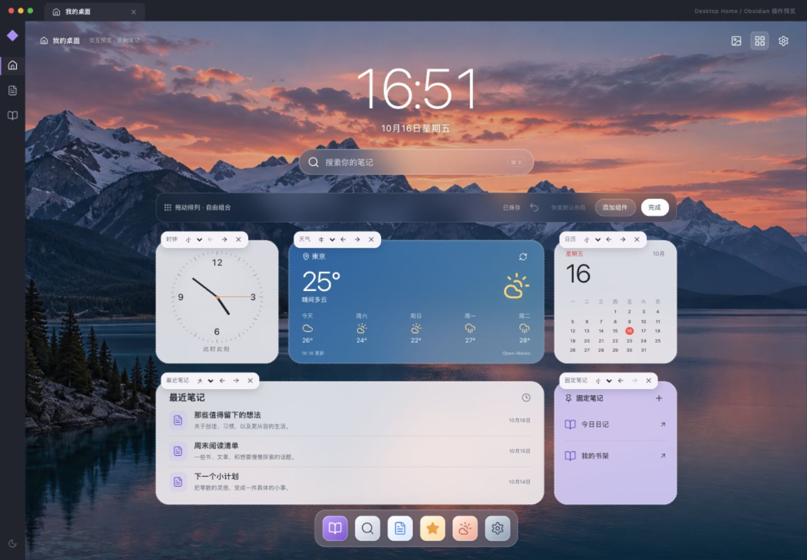

# Desktop Home

Obsidian 个人桌面首页，采用苹果桌面视觉：壁纸、大时钟、笔记搜索、可配置组件与底部 Dock。

当前版本：0.1.1，电脑端开发预览版。尚未提交 Obsidian 社区插件审核，真实 Obsidian 应用内安装验收仍待进行。



截图中的笔记为演示数据，天气城市为测试时选择的东京。

## 使用

安装后点击左侧「打开桌面首页」图标，或在命令面板运行 `Desktop Home: 打开桌面首页`。

- 首页右上角图片按钮：晴空 / 午夜 / 暖纸主题，内置山湖或渐变壁纸，本地图片上传、明暗和模糊。
- 网格按钮：进入编辑模式，拖动组件排序、选小中大尺寸、移除和添加组件。也可以使用组件上方的前后按钮调整顺序。支持撤销最近 20 步布局修改、Cmd/Ctrl+Z 和恢复默认布局；主题、壁纸和固定笔记保持原样，恢复布局也能撤销。
- 搜索：在当前库的 Markdown 标题和文件路径中查询。支持方向键、Enter、Escape；首页焦点内支持 Cmd/Ctrl+K。
- 固定笔记：选择库内的笔记，文件或所在文件夹在插件启用期间改名时自动更新路径。文件删除后可在管理面板取消固定。插件停用期间的改名无法自动追踪。
- 日历与 Dock 的日记入口：打开或创建 `日记/YYYY-MM-DD.md`，现有文件不会覆盖。此入口使用本插件的固定路径，暂未读取 Daily notes 插件设置。
- 天气：主动查询并选择城市后启用。Open-Meteo 请求只包含城市名或坐标；30 分钟缓存，联网失败显示缓存时间。可在城市面板停用并清除已保存城市。
- 设置：可开启「启动时打开首页」，默认关闭。

组件使用网格排列与预设尺寸，展开后增加显示内容。主题、壁纸与布局分别保存，切换外观保留布局。

## 本地安装

先下载或克隆源码，在项目目录运行以下命令生成安装包（开发构建需要 Node.js 22+；打包脚本目前使用 macOS / Linux 的 `/usr/bin/zip`）：

```sh
npm ci
npm run build
```

1. 解压 `dist/desktop-home-0.1.1.zip`，得到 `desktop-home` 文件夹。
2. 将整个文件夹放入目标库的 `.obsidian/plugins/`，保留其中 `assets/`。
3. 在 Obsidian 设置的第三方插件中启用 Desktop Home；必要时重新启动 Obsidian。

安装包含 `main.js`、`manifest.json`、`styles.css`、`assets/alpine.png`。尚未自动安装到个人笔记库。

## 开发和验证

```sh
npm ci
npm run dev
npm run check
```

浏览器预览复用插件的全部首页界面。预览中的笔记为示例，打开笔记会显示示例弹窗；配置写入浏览器 localStorage，插件配置写入当前库的插件 data.json。浏览器中的当日日记只保存在当前页面内存中。

`npm run build` 生成安装目录与 ZIP；`npm run build:preview` 生成静态预览。配置调整会在停止操作 250ms 后合并保存，关闭视图时提交最后状态；编辑栏显示保存结果，失败可重试。外观更新复用原有组件，笔记列表按库事件刷新快照。

测试覆盖配置恢复、布局尺寸与排序、搜索、天气缓存、连续保存与重试、固定路径改名和界面核心交互。开发结构和验证范围见 [开发说明](docs/development.md)。真实 Obsidian 应用内安装验收尚未进行。

## 数据与服务

无遥测、无账户。壁纸均在本地读取；上传的 PNG/JPG/WebP（最多 5 MB）编码保存在配置中，可能增加库同步体积。笔记标题和路径用于本地搜索，不发送到天气服务。

天气数据来源 [Open-Meteo](https://open-meteo.com/)，数据许可 CC BY 4.0。当前默认 API 用于个人非商业使用和原型验证；商业发布前需要根据 [服务条款与用量](https://open-meteo.com/en/pricing) 调整服务方案。天气和城市查询依赖外部网络可用性。

内置山湖壁纸为本项目通过内置 imagegen 生成的图片；图标来自 [Lucide](https://lucide.dev/)，ISC 许可证，见 `THIRD_PARTY_NOTICES.md`。
