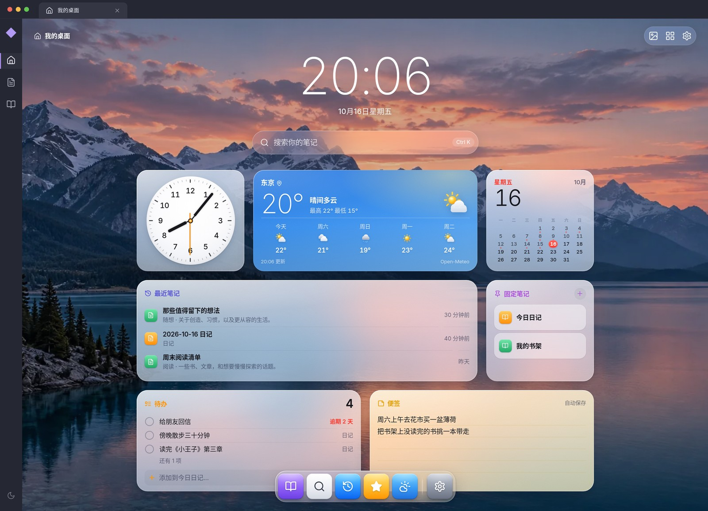
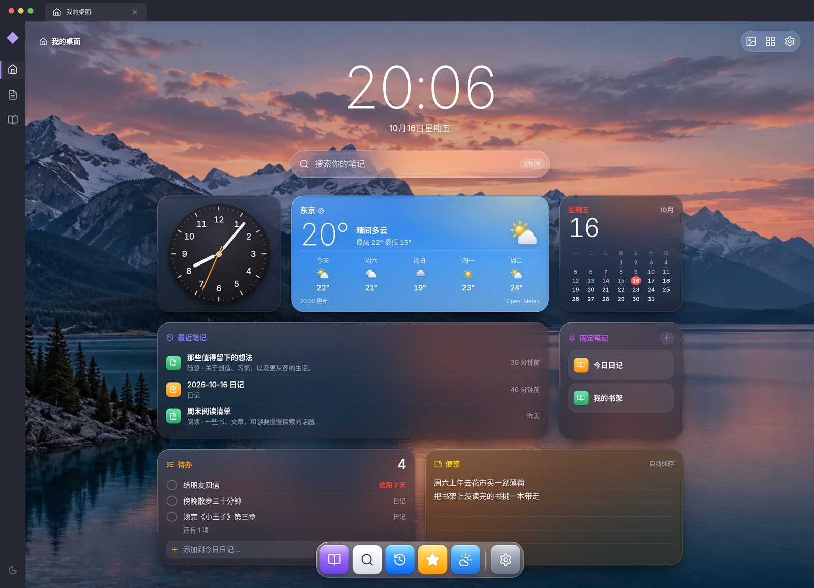
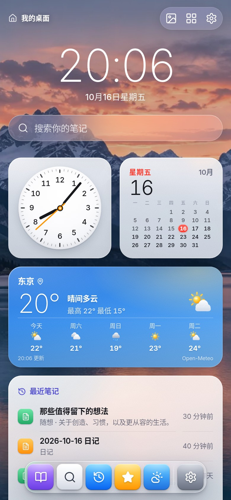
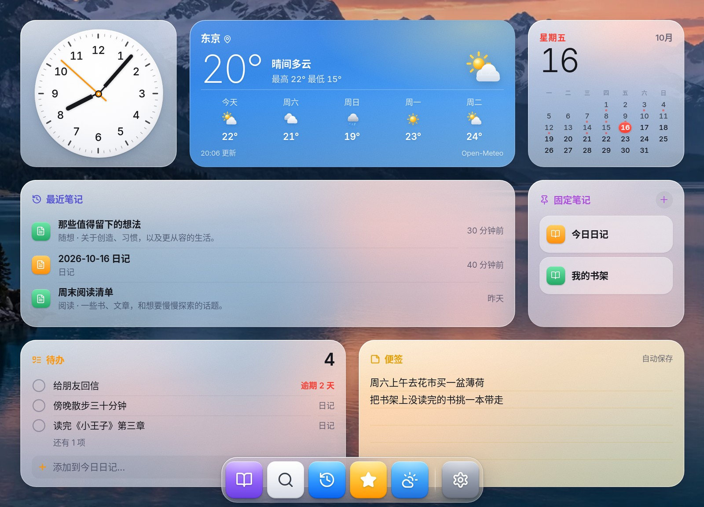

# Desktop Home

Obsidian 个人桌面首页，采用苹果桌面视觉：壁纸、大时钟、笔记搜索、可配置组件与底部 Dock。

当前版本：0.2.0。电脑端与手机端均可使用；尚未提交 Obsidian 社区插件审核。



| 深色（跟随 Obsidian） | 手机 |
| --- | --- |
|  |  |



截图中的笔记、待办与天气均为演示数据。

## 使用

安装后点击左侧「打开桌面首页」图标，或在命令面板运行 `Desktop Home: 打开桌面首页`。

- **外观**（首页右上角图片按钮）：自动 / 晴空 / 午夜 / 暖纸主题。「自动」跟随 Obsidian 的明暗模式。壁纸可选内置山湖、渐变、上传图片（自动缩小后保存），或直接选用笔记库里的图片（只记路径，改名会自动跟随）；可调明暗和模糊。
- **编辑桌面**（网格按钮）：拖动组件排序、选小中大尺寸、移除和添加组件，也可用组件上方的前后按钮。支持撤销最近 20 步、Cmd/Ctrl+Z 和恢复默认布局。
- **搜索**：在标题、别名和路径中查找。方向键、Enter、Escape；首页内 Cmd/Ctrl+K 聚焦搜索。没有同名笔记时，最后一项是「新建笔记」，按 Enter 直接创建并打开。
- **组件**
  - 时钟、天气、日历、最近笔记、固定笔记。
  - 日历：有日记的日子会标出来；中、大尺寸可以点任意一天打开（或新建）那天的日记。
  - 待办（新）：显示今日日记里的 `- [ ]`，以及已到期或逾期的任务（识别 Tasks 插件的 `📅 日期` 与 Dataview 的 `[due:: 日期]`）。点圆圈即完成；在输入框里写一句就追加到今日日记。
  - 便签（新）：随手记一句话，自动保存，不新建笔记。
- **日记**：默认跟随核心「日记」插件的文件夹、日期格式和模板；未启用核心插件时使用本插件设置（默认 `日记/YYYY-MM-DD.md`）。现有文件不会被覆盖。
- **固定笔记**：文件或所在文件夹在插件启用期间改名时自动更新路径。
- **天气**：主动选择城市后启用，30 分钟缓存，联网失败显示缓存时间。

## 设置

Obsidian 设置 → Desktop Home，分三组：

- 基础：打开首页、启动时打开首页、24 小时制、主题。
- 日记：跟随核心「日记」插件、日记文件夹、文件名格式。
- 高级：搜索时忽略的文件夹（不出现在搜索、最近笔记和待办中）、停用天气、数据与隐私说明。

## 本地安装

```sh
npm ci
npm run build
```

生成 `dist/desktop-home/`，把整个文件夹放进目标库的 `.obsidian/plugins/`，然后在第三方插件中启用 Desktop Home。安装只需要 `main.js`、`manifest.json`、`styles.css` 三个文件——内置壁纸已经打包进 `main.js`，所以从社区插件市场安装也能正常显示。

## 开发和验证

```sh
npm ci
npm run dev      # 浏览器预览，示例笔记
npm run verify   # 类型检查 + ESLint（eslint-plugin-obsidianmd）+ CSS 兼容检查 + 单元测试 + 插件构建 + 预览构建
```

浏览器预览复用插件的全部首页界面；`?shot=1` 去掉预览标注，`?mobile=1` 模拟手机端。开发结构见 [开发说明](docs/development.md)。

## 数据与网络

- 无遥测、无账户。配置、便签和上传的壁纸保存在本库的插件 `data.json` 中，会随库同步。
- 笔记标题和路径只用于本地搜索。待办只读取含有未完成任务的笔记，勾选或添加待办时才会修改对应笔记的那一行。
- **网络使用**：只有天气功能会联网，且默认关闭。选择城市后，插件向 [Open-Meteo](https://open-meteo.com/) 发送城市名（查城市时）或经纬度（查天气时），不发送任何笔记内容。可在城市面板或插件设置中停用并清除城市。
- 天气数据来源 Open-Meteo，数据许可 CC BY 4.0；默认 API 用于个人非商业使用，商业发布前需按其 [服务条款](https://open-meteo.com/en/pricing) 调整方案。

内置山湖壁纸为本项目生成的图片（见 [生成记录](docs/wallpaper-generation.md)）；图标来自 [Lucide](https://lucide.dev/)，ISC 许可证，见 `THIRD_PARTY_NOTICES.md`。

## 许可证

[MIT](LICENSE)
